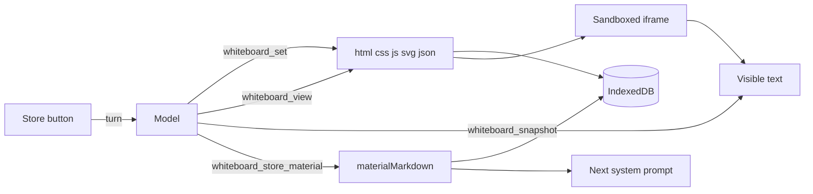

# Whiteboard as HTML, CSS, JS, SVG, and JSON

The live board stops being a markdown lesson. Each topic stores five sources, and the page paints them in a sandboxed iframe. Markdown is a separate document the model writes only when the learner chooses to store the learning material.

## Stored topic

In [`src/types.ts`](src/types.ts), replace `documentMarkdown` with:

- `html`, `css`, `js`, `svg`, `json` — the live page, each `""` when unused
- `materialMarkdown` — `""` until the learner stores

Bump `DB_VERSION` to 2 in [`src/storage/db.ts`](src/storage/db.ts). In the upgrade, walk existing topics: copy `documentMarkdown` into `materialMarkdown`, turn that markdown into static HTML with the current `renderMarkdown` path (no script), and clear `css`, `js`, `svg`, and `json`. New topics from `createEmptyTopic` start with all six strings empty.

Each field is capped at 200,000 characters, the same limit the markdown tools use today. `whiteboard_set` for `json` accepts only a string that `JSON.parse` accepts, and stores that string unchanged. An empty string means there is no data.

## How the board renders

[`src/ui/whiteboard.ts`](src/ui/whiteboard.ts) paints an iframe instead of sanitized lesson HTML. The parent assigns `iframe.srcdoc`; it never inserts the model string with `innerHTML`.

- `sandbox="allow-scripts"` only. No `allow-same-origin`, so the page script cannot read IndexedDB, the parent DOM, or the model API.
- A CSP inside the frame: `default-src 'none'; script-src 'unsafe-inline'; style-src 'unsafe-inline'; img-src data: https:;`. Animation can run. Network requests from the lesson cannot.
- The assembled document is a doctype, then the CSS in `<style>`, then a body in this order:
  - `
` containing the SVG, omitted when `svg` is empty
  - the HTML
  - a script that sets `globalThis.lessonData` from the JSON, or `null` when `json` is empty. `<` in that script is escaped so the JSON cannot close the script tag
  - the user JS in a following `<script>`
- An empty board (all five sources blank) still shows the existing placeholder. [`src/main.ts`](src/main.ts) passes the five strings into `renderWhiteboard`.

The topic title comes from the first `<h1>` in the HTML, read with `DOMParser` so the script does not run. SVG text does not set the title. If there is no `<h1>`, the title stays as it is, or `"New topic"` for a new board.

## Tools

Replace the five markdown tools in [`src/llm/tools.ts`](src/llm/tools.ts) with four. Descriptions stay imperative, because prompted tool calling uses them as instructions.

- `whiteboard_view` — `component` is `html`, `css`, `js`, `svg`, `json`, or `all`. Returns that source. If `all` is longer than about 24,000 characters, return only the five lengths and tell the model to view one component.
- `whiteboard_set` — `component` plus `source`. Replaces that one source, saves, and repaints. The tool result is the component name, the character count, and the title when the component is `html`. It does not echo the source. Invalid JSON throws, and the stored JSON is left unchanged.
- `whiteboard_snapshot` — no input. Parses the current HTML and SVG with `DOMParser` and returns their visible text, truncated if long, plus the character counts of every source. This is not saved.
- `whiteboard_store_material` — `markdown`. Saves `materialMarkdown` only. It does not change the live page. The model calls this when the learner asks to store the learning material.

Section edit helpers in [`src/document/ops.ts`](src/document/ops.ts) stay in the repo. The live board no longer calls them. [`src/document/markdown.ts`](src/document/markdown.ts) still parses the stored markdown so it can be fitted into the prompt.

## What the model is told

Replace the fixed instructions in [`src/llm/system-prompt.ts`](src/llm/system-prompt.ts). The system message says:

- The whiteboard is a page of `html`, `css`, `js`, `svg`, and `json`. Change it only with whiteboard tools.
- The SVG is inserted in `#lesson-svg`. Draw with basic shapes (`rect`, `circle`, `line`, `polygon`, `text`), not long path data. Do not paste that same diagram into `html`.
- Parsed JSON is `lessonData` inside the page, or `null` when `json` is empty. Put labels, steps, and numbers there when the script should stay stable.
- The chat stays short and does not contain the page source.
- On an empty board, write the page with `whiteboard_set`.
- Call `whiteboard_view` before editing a component, and `whiteboard_snapshot` to read what the page currently says.
- `materialMarkdown` exists only after the learner stores. It is not the live page.

The message then includes component lengths, or "The whiteboard is empty." When `materialMarkdown` is non-empty, it is appended as stored learning material and fitted with the existing section budget. The raw sources are not inlined. [`src/llm/turn.ts`](src/llm/turn.ts) builds the prompt from those fields. A successful `whiteboard_set` or `whiteboard_store_material` still destroys the session so the next send sees the new state.

The empty-board chat fallback stops looking for a `#` heading. If the board is empty, no tool ran, and the reply is a long HTML fragment, that reply is saved as `html` and the chat is replaced with the short fallback sentence.

## Store button

The board toolbar in [`src/ui/shell.ts`](src/ui/shell.ts) is hidden on wide screens today (`display: none` until 900px) because it only holds the Topics toggle. Show the toolbar on all widths. Keep the Topics toggle for the narrow layout, and add **Store learning material**.

The button sends one user turn: ask the model to write a markdown document of what the page teaches and call `whiteboard_store_material`, without changing `html`, `css`, `js`, `svg`, or `json`. It is disabled while a turn is busy or while all five sources are empty.

## Tests and spec

Update [`src/llm/system-prompt.test.ts`](src/llm/system-prompt.test.ts) and [`src/llm/turn.test.ts`](src/llm/turn.test.ts) for the new prompt, the HTML fallback, and a tool write that lands in `html` and shows up as lengths on the next system message. Add tests for view, set, snapshot, and store, including the open-topic guard, invalid JSON, and the iframe: `sandbox` is `allow-scripts`, `srcdoc` contains the five sources, `#lesson-svg` and `lessonData` are present, and the parent board does not parse them as its own HTML.

Update the whiteboard, tools, and storage sections of [`doc/BUILD_PLAN.md`](doc/BUILD_PLAN.md) so they match this contract.

After `npm test`, open the app and confirm a blank board shows the placeholder, and a seeded topic renders its HTML, CSS, script, SVG, and JSON inside the sandboxed frame.
